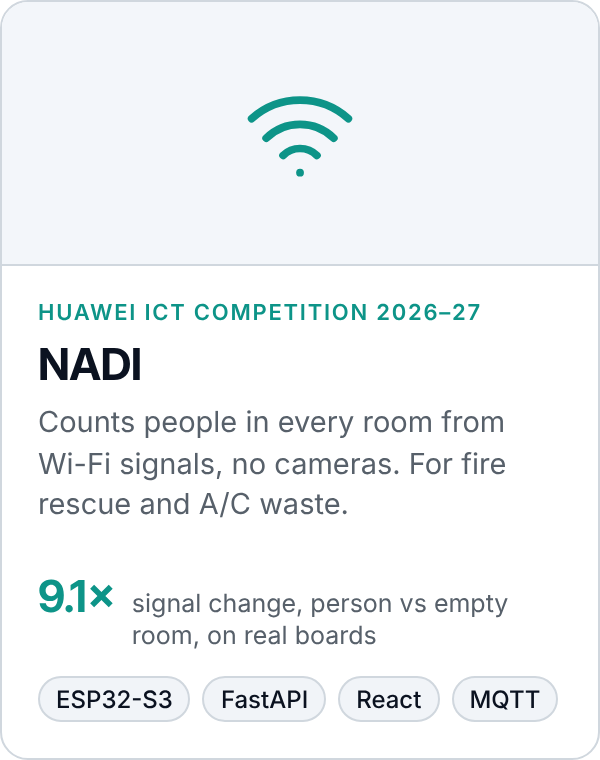
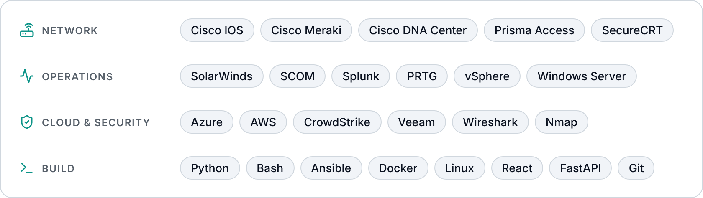

<picture>
  <source media="(prefers-color-scheme: dark)" srcset="assets/banner-dark.svg">
  
</picture>

IT Operations intern at PPG. I keep sites in multiple countries online, and build the tools I wish I had.

### Selected work

  <a href="https://github.com/aimannurzharfan/NADI"><picture><source media="(prefers-color-scheme: dark)" srcset="assets/card-nadi-dark.png"></picture></a>
  <a href="https://github.com/aimannurzharfan/SDN-Multi-Window-DDoS"><picture><source media="(prefers-color-scheme: dark)" srcset="assets/card-sdn-dark.png"></picture></a>
  <a href="https://github.com/aimannurzharfan/Netguard-Sentinel"><picture><source media="(prefers-color-scheme: dark)" srcset="assets/card-ng-dark.png"></picture></a>

### Toolbox

<picture>
  <source media="(prefers-color-scheme: dark)" srcset="assets/toolbox-dark.png">
  
</picture>

### Certifications

  <a href="https://www.linkedin.com/in/nurzharfan/details/certifications/"><picture><source media="(prefers-color-scheme: dark)" srcset="assets/cert-oracle-ai-dark.svg"></picture></a>
  <a href="https://www.linkedin.com/in/nurzharfan/details/certifications/"><picture><source media="(prefers-color-scheme: dark)" srcset="assets/cert-oracle-data-dark.svg"></picture></a>
  <a href="https://www.linkedin.com/in/nurzharfan/details/certifications/"><picture><source media="(prefers-color-scheme: dark)" srcset="assets/cert-huawei-datacom-dark.svg"></picture></a>

### Hands-on labs

<b>More projects</b>

 

| Project | What it is |
| --- | --- |
| [SkillForge](https://github.com/aimannurzharfan/SkillForge) | Role-readiness agent on Microsoft Foundry: mock assessment, readiness score, grounded learning plan |
| [Network-Design](https://github.com/aimannurzharfan/Network-Design) | Two-floor campus network in Packet Tracer with OSPF, VLANs, ACLs and NAT |
| [Network-Programming](https://github.com/aimannurzharfan/Network-Programming) | Ansible playbooks for a Cisco CSR1000v, plus a Dockerised dashboard |
| [PintarKod](https://github.com/aimannurzharfan/PintarKod) | Mobile app that teaches Form 4 Computer Science through games, with an AI tutor |
| [CipherAgent Academy](https://github.com/aimannurzharfan/CipherAgent-Academy) | Web game teaching Rail Fence, Diffie-Hellman and man-in-the-middle attacks |
| [2D-Heat-Diffusion](https://github.com/aimannurzharfan/2D-Heat-Diffusion) | Heat simulation parallelised with MPI and OpenMP |
| [Network-Scanner](https://github.com/aimannurzharfan/Network-Scanner) | The first NetGuard: multi-threaded port scanner with PDF reports |
| [Packet-Monitor](https://github.com/aimannurzharfan/Packet-Monitor) | Packet transmission monitor built in digital logic |

  <a href="https://linkedin.com/in/nurzharfan">LinkedIn</a> &nbsp;·&nbsp;
  <a href="mailto:aimannurzharfan17@gmail.com">Email</a> &nbsp;·&nbsp;
  <a href="https://behance.net/nurzharfan">Behance</a>

