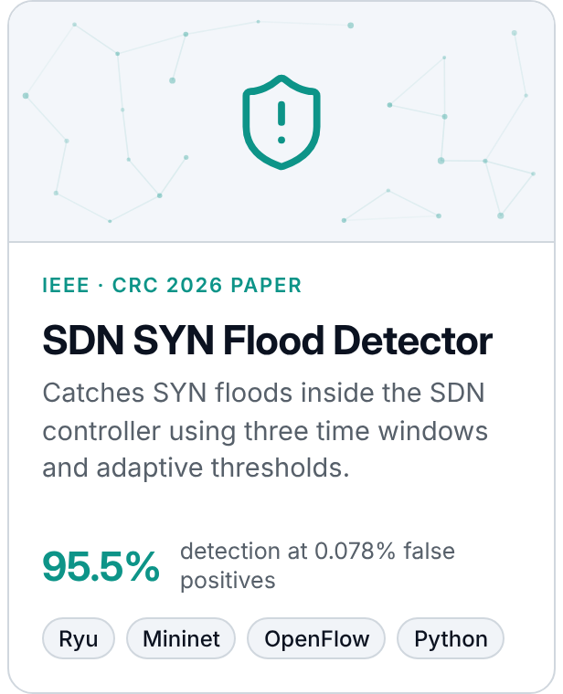
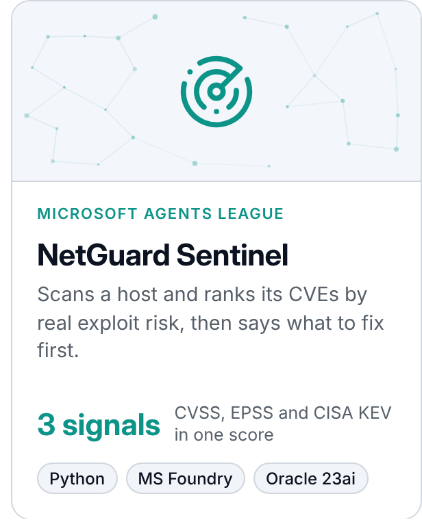
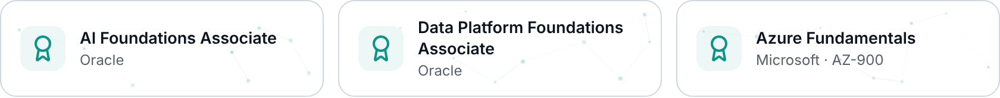
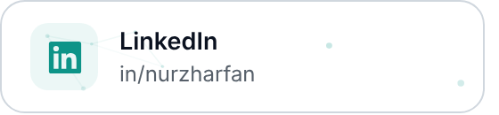
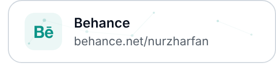

<picture>
  <source media="(prefers-color-scheme: dark)" srcset="assets/banner-dark.svg">
  
</picture>

### Selected work

<a href="https://github.com/aimannurzharfan/NADI"><picture><source media="(prefers-color-scheme: dark)" srcset="assets/card-nadi-dark.png"></picture></a><a href="https://github.com/aimannurzharfan/SDN-Multi-Window-DDoS"><picture><source media="(prefers-color-scheme: dark)" srcset="assets/card-sdn-dark.png"></picture></a><a href="https://github.com/aimannurzharfan/Netguard-Sentinel"><picture><source media="(prefers-color-scheme: dark)" srcset="assets/card-ng-dark.png"></picture></a>

### Toolbox

<picture>
  <source media="(prefers-color-scheme: dark)" srcset="assets/toolbox-dark.png">
  
</picture>

### Certifications

<a href="https://www.linkedin.com/in/nurzharfan/details/certifications/"><picture>
  <source media="(prefers-color-scheme: dark)" srcset="assets/certs-dark.png">
  
</picture></a>

### Contact

<a href="https://www.linkedin.com/in/nurzharfan"><picture><source media="(prefers-color-scheme: dark)" srcset="assets/ct-linkedin-dark.png"></picture></a><a href="mailto:aimannurzharfan17@gmail.com"><picture><source media="(prefers-color-scheme: dark)" srcset="assets/ct-email-dark.png"></picture></a><a href="https://www.behance.net/nurzharfan"><picture><source media="(prefers-color-scheme: dark)" srcset="assets/ct-behance-dark.png"></picture></a>

